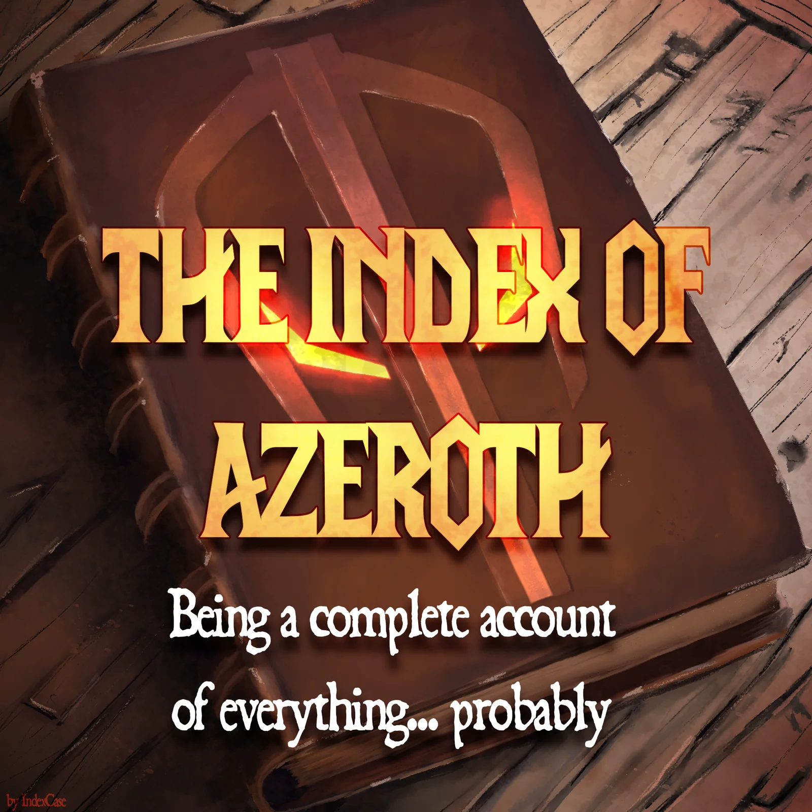

# The Index of Azeroth

*Being a complete account of everything... probably.*

The Index of Azeroth is a companion for World of Warcraft: Forever. It runs on your PC beside the game. It shows a map of Azeroth with your character on it and plans your levelling: which quests to take, in what order and where to go next. A small addon shows the same plan in the game.

**What it does**

- Shows a map of Azeroth with a full day-night cycle and a simulated sea. Your character's position and facing update live as you play.
- Plans quests for a zone, a dungeon or a set of quests you choose, and redoes the plan whenever your quest log changes.
- Leads you to each step with an arrow in the game and names the step on a card.
- Keeps a record of your alts, with their gear and bags as they were when you last logged out.
- Saves a complete log of your play on your PC, which you can replay on the map.
- So much more. "Kitchen sink" should be redefined and show this tool in the wiki.

Nothing you play leaves your PC. The Index connects to the internet only to check for updates and, if you open its video window, to play the stream you choose.

**Getting started**

1. Download `IndexOfAzeroth.zip` from the latest release.
2. Unpack it wherever you like and double-click **Start the Index**.
3. Windows may ask whether you really want to run it, because it comes from the internet and isn't signed. Choose **Run**.

The Index finds your game by itself and uses the game's own data. It installs its addon while the game is closed, so the addon appears after you restart the game. Each time it starts, it checks this page on GitHub for a new release, and it takes the liberty of installing small updates by itself.

To remove it, delete its folder and the `IndexOfAzeroth` folder in your game's AddOns folder. The notes it keeps about your characters are set aside first, never deleted.

If you'd like to tip, the Index has a Ko-fi page: [ko-fi.com/indexcase](https://ko-fi.com/indexcase).

**Credits**

The dangerous-mob notes come from RestedXP, under CC BY-NC-SA 4.0. No other RestedXP data has been used. World of Warcraft and its art © Blizzard Entertainment, Inc.

The Index of Azeroth. Copyright 2026 Index Case. PolyForm Strict 1.0.0, see LICENSE.md.
